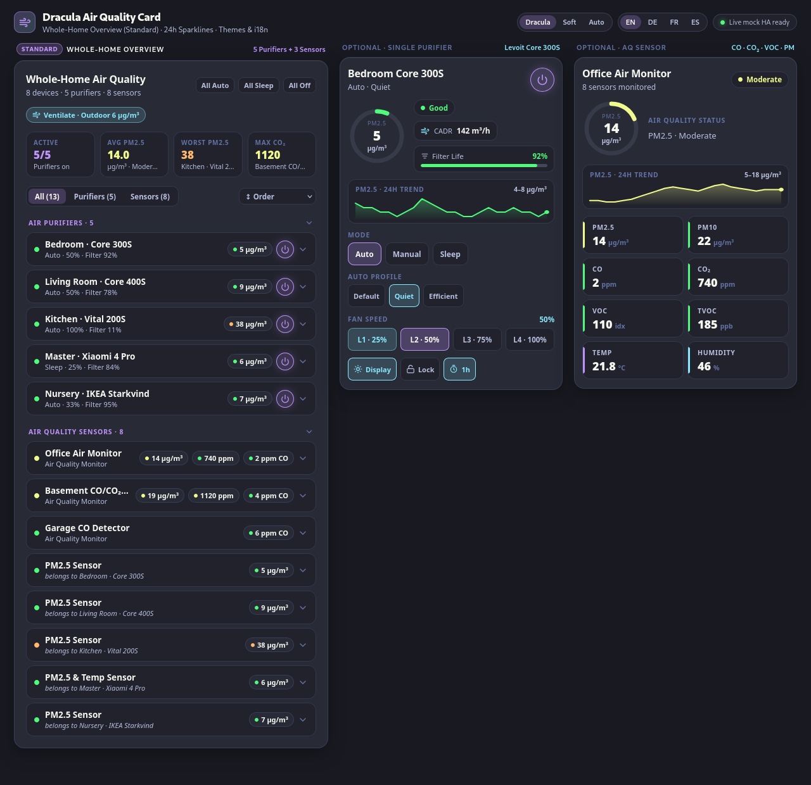

# Dracula Air Quality Card

[](https://wakuwakumiwaku.github.io/dracula-air-quality-card/)
[](https://github.com/hacs/integration)
[](https://github.com/wakuwakumiwaku/dracula-air-quality-card/actions/workflows/validate.yml)
[](./LICENSE)

A zero-dependency Home Assistant Lovelace custom card built around a **Whole-Home Air Quality Overview** for grouped air purifiers and CO/CO₂/VOC/PM sensors — with optional focused modes for a single purifier or standalone air quality monitor — styled with the [Dracula](https://draculatheme.com/) palette.

**[Try the Live Interactive Demo →](https://wakuwakumiwaku.github.io/dracula-air-quality-card/)**



## Features

- **2-Line Zero-Config Auto-Discovery (`auto_discover: true`)** — Automatically scans Home Assistant for all `fan.*` purifiers and standalone AQ monitors (by `device_class`), attaches companion sensors, and groups them cleanly out of the box (with optional `exclude_entities`).
- **Whole-Home Air Quality Overview (Standard Default)** — Monitor and control every purifier and air quality sensor in your home from one card:
  - Live summary strip showing **Active Purifiers**, **Average PM2.5**, **Worst PM2.5**, **Max CO₂**, and a red **CO Warning** tile if any sensor detects elevated CO (`>= 35 ppm`) or an active CO/gas alarm.
  - One-tap master controls (**All Auto**, **All Sleep**, **All Off**) across all purifiers.
  - Native **`group_by`** sections (`type`, `room`, or `none`) with collapsible group headers (`Air Purifiers · N`, `Air Quality Sensors · N`) and **`All | Purifiers | Sensors`** filter tabs.
  - **Smart Sorting (`sort_by`)** — Sort rooms within each group by worst PM2.5 (`pm25`), lowest filter life (`filter`), or alphabetically (`name`), with a live sort selector in the header.
  - Compact expandable room rows that scale cleanly to 10+ rooms with inline purifier controls, 24h trend sparklines, and full sensor drawers.
- **Contextual Ventilation Advisor (`outdoor_pm25_entity` / `outdoor_aqi_entity`)** — Stays completely hidden when indoor air is clean. When indoor CO₂ (`>= 1000 ppm`), PM2.5 (`> 25 µg/m³`), or VOC rises, displays a compact localized pill advising **Ventilate · Outdoor X µg/m³** (cyan, when outdoor air is clean) or **Keep Closed · Outdoor X µg/m³** (amber, when outdoor air is polluted).
- **Safe 2-Tap Filter Reset (`filter_reset_entity`)** — Auto-discovers `button.<prefix>_filter_reset` and stays hidden while filters are healthy. When filter life drops to `<= 15%` (or `filter_low` is active), shows a reset button with a 5-second **Confirm Reset?** safeguard before calling `button.press`.
- **Inline 24h SVG Sparklines** — Enabled by default (`show_sparklines: true`). Fetches 24-hour history via Home Assistant's history API with a 5-minute per-entity cache (plus an in-memory rolling fallback) and renders smooth gradient sparklines in Purifier Mode, Standalone AQ Sensor Mode, and expanded Overview drawers.
- **Optional Single-Device Modes** — Dedicated **Single Purifier Mode** and **Standalone Air Quality Sensor Mode** supporting **PM2.5, PM10, PM1.0, AQI, CO, CO₂, VOC, tVOC, NOₓ, NO₂, O₃, HCHO (Formaldehyde), Radon, Temperature, Humidity, Pressure**, plus red safety banners for elevated CO or active `co_alarm` / `gas_alarm` sensors.
- **Custom Thresholds, Themes & Built-in i18n** — Override WHO/EPA breakpoints via `thresholds`, pick `theme: "dracula" | "dracula-soft" | "auto"`, and enjoy automatic localization (`language: "auto" | "en" | "de" | "fr" | "es"`).
- **Fast & Responsive** — Uses shared `CSSStyleSheet` (`adoptedStyleSheets`), single delegated event listeners, and state-fingerprint render-skipping for minimal overhead, plus CSS `@container` queries from 360px mobile screens to wide desktops.

## Supported Purifiers & Air Quality Sensors

Works out of the box with:

- **Air Purifiers:**
  - **Levoit** — ESPHome (`tuct/levoit`) and VeSync integrations (Core 300S, Core 400S, Core 600S, Vital 100S/200S, etc.)
  - **Xiaomi MIoT** — Air Purifier 4, 4 Pro, 4 Compact, 3H, and compatible MIoT models
  - **Philips CoAP** — AirPurifier integration
  - **IKEA** — Starkvind air purifier
  - **Dyson** — Purifier Cool / Hot+Cool integrations
- **Air Quality & Gas Sensors:**
  - **Apollo Automation** — AIR-1 multi-sensor
  - **AirGradient** — ONE and Open Air monitors
  - **IKEA** — Vindstyrka air quality sensor
  - **Netatmo** — Smart Indoor Air Quality Monitor & Weather Station
  - **Awair** — Awair Element
  - **Qingping** — Air Monitor / Air Monitor Lite
  - **Aqara** — TVOC Air Quality Monitor
  - **Zigbee / Matter CO & Gas Detectors** — Any CO ppm sensor or `co_alarm` / `gas_alarm` binary sensor
  - **DIY ESPHome Sensors** — SCD40 / SCD41 (CO₂), SGP40 / SGP41 (VOC/NOₓ), MQ-7 (CO), PMS5003 / SEN55 (PM), and more
- **Generic Home Assistant Entities** — Any `fan.*`, `sensor.*`, `binary_sensor.*`, `select.*`, `switch.*`, `light.*`, `lock.*`, `number.*`, or `button.*` entity

## Installation

### HACS (Recommended)

1. Open **HACS** in Home Assistant.
2. Click the three-dots menu in the top right and select **Custom repositories**.
3. Add `https://github.com/wakuwakumiwaku/dracula-air-quality-card` with category **Dashboard** (or **Lovelace**).
4. Search for **Dracula Air Quality Card** and click **Download**.
5. Reload your browser cache (`Ctrl+Shift+R` / `Cmd+Shift+R`).

### Manual

1. Download `dracula-air-quality-card.js` from the latest release.
2. Copy it to `/config/www/dracula-air-quality-card.js`.
3. In Home Assistant, go to **Settings → Dashboards → Resources → Add Resource**:
   - **URL:** `/local/dracula-air-quality-card.js`
   - **Resource type:** `JavaScript Module`
4. Refresh your browser.

## Quick Start: Whole-Home Air Quality Overview (Standard)

### 2-Line Zero-Config Setup

Let the card discover every air purifier and air quality sensor in Home Assistant automatically:

```yaml
type: custom:dracula-air-quality-card
auto_discover: true
```

Add an outdoor PM2.5 sensor for the contextual Ventilation Advisor and exclude any fans you do not want listed (such as bathroom exhaust fans):

```yaml
type: custom:dracula-air-quality-card
auto_discover: true
outdoor_pm25_entity: sensor.outdoor_pm25
exclude_entities:
  - fan.bathroom_exhaust
  - fan.ceiling_fan
```

### Explicit Multi-Room Configuration

For full control over room labels, custom order, and mixed purifier + sensor entries:

```yaml
type: custom:dracula-air-quality-card
name: Whole-Home Air Quality
theme: dracula
language: auto
group_by: type
sort_by: pm25
show_sparklines: true
outdoor_pm25_entity: sensor.outdoor_pm25
devices:
  - entity: fan.bedroom_levoit_core_300s
    name: Bedroom · Core 300S
    room: Upstairs
  - entity: fan.living_room_levoit_core_400s
    name: Living Room · Core 400S
    room: Main Floor
  - entity: fan.kitchen_levoit_vital_200s
    name: Kitchen · Vital 200S
    room: Main Floor
  - entity: fan.master_xiaomi_4_pro
    name: Master · Xiaomi 4 Pro
    room: Upstairs
  - entity: fan.nursery_ikea_starkvind
    name: Nursery · IKEA Starkvind
    room: Upstairs
  - name: Office Air Monitor
    room: Main Floor
    sensors:
      pm25: sensor.office_air_pm25
      pm10: sensor.office_air_pm10
      co: sensor.office_air_co
      co2: sensor.office_air_co2
      voc: sensor.office_air_voc
      tvoc: sensor.office_air_tvoc
      temperature: sensor.office_air_temperature
      humidity: sensor.office_air_humidity
  - name: Basement CO/CO₂/VOC
    room: Basement
    sensors:
      pm25: sensor.basement_air_pm25
      co: sensor.basement_air_co
      co2: sensor.basement_air_co2
      voc: sensor.basement_air_voc
      hcho: sensor.basement_air_hcho
      radon: sensor.basement_air_radon
      temperature: sensor.basement_air_temperature
      humidity: sensor.basement_air_humidity
  - name: Garage CO Detector
    room: Garage
    sensors:
      co: sensor.garage_co
      co_alarm: binary_sensor.garage_co_alarm
      temperature: sensor.garage_temperature
      humidity: sensor.garage_humidity
```

- **Group by type (`group_by: type`, default):** Separates devices into collapsible **Air Purifiers** and **Air Quality Sensors** sections and displays `All | Purifiers | Sensors` filter tabs.
- **Group by room (`group_by: room`):** Groups entries by each item's `room` (or `group`) label, falling back to `"Other"`.
- **Flat list (`group_by: none`):** Shows all devices in a single list without section headers.
- **Sorting (`sort_by`):** Choose `default`, `pm25` (worst PM2.5 first), `filter` (lowest filter life first), or `name` (A–Z), or switch live from the Overview header.

### Custom Thresholds, Soft Theme & Language

```yaml
type: custom:dracula-air-quality-card
name: Whole-Home Air Quality
theme: dracula-soft
language: de
auto_discover: true
outdoor_pm25_entity: sensor.outdoor_pm25
thresholds:
  pm25:
    good: 10
    moderate: 25
    sensitive: 50
    unhealthy: 100
  co2:
    good: 750
    moderate: 1100
    poor: 1600
  co:
    good: 9
    elevated: 30
    dangerous: 60
```

## Optional Single-Device Modes

If you also want a focused room card for a single purifier or standalone sensor, the same card supports both optional modes.

### Single Purifier Mode (Optional)

Minimal configuration using automatic sibling entity discovery:

```yaml
type: custom:dracula-air-quality-card
entity: fan.bedroom_levoit_core_300s
name: Bedroom Purifier
```

With explicit entity overrides (including 2-tap filter reset):

```yaml
type: custom:dracula-air-quality-card
entity: fan.bedroom_levoit_core_300s
name: Bedroom Core 300S
theme: dracula
show_cadr: true
show_filter: true
show_timer: true
show_sparklines: true
pm25_entity: sensor.bedroom_levoit_core_300s_pm25
cadr_entity: sensor.bedroom_levoit_core_300s_cadr
filter_entity: sensor.bedroom_levoit_core_300s_filter_life
filter_reset_entity: button.bedroom_levoit_core_300s_filter_reset
display_entity: switch.bedroom_levoit_core_300s_display
child_lock_entity: switch.bedroom_levoit_core_300s_display_lock
operating_mode_entity: select.bedroom_levoit_core_300s_fan_mode
auto_mode_entity: select.bedroom_levoit_core_300s_auto_mode
timer_entity: number.bedroom_levoit_core_300s_timer
timer_remaining_entity: sensor.bedroom_levoit_core_300s_timer_remaining
```

### Standalone Air Quality Sensor Mode (Optional)

Monitor CO, CO₂, VOC/tVOC, particulates, HCHO, Radon, or climate metrics without a purifier fan entity:

```yaml
type: custom:dracula-air-quality-card
mode: sensor
name: Office Air Monitor
outdoor_pm25_entity: sensor.outdoor_pm25
show_sparklines: true
sensors:
  pm25: sensor.office_air_pm25
  pm10: sensor.office_air_pm10
  co: sensor.office_air_co
  co2: sensor.office_air_co2
  voc: sensor.office_air_voc
  tvoc: sensor.office_air_tvoc
  temperature: sensor.office_air_temperature
  humidity: sensor.office_air_humidity
  co_alarm: binary_sensor.office_co_alarm
```

## Options

### Main Options

| Option | Type | Default | Description |
| --- | --- | --- | --- |
| `type` | `string` | **Required** | `custom:dracula-air-quality-card` |
| `auto_discover` | `boolean` | `false` | Automatically discover all `fan.*` purifiers and standalone AQ sensors in Home Assistant |
| `exclude_entities` | `list` | `[]` | Entity IDs to skip when `auto_discover: true` is enabled |
| `devices` | `list` | — | **Standard mode:** List of entity IDs (`"fan.room"`) or device objects (`{ entity, name, room, group, sensors, ... }`) for Whole-Home Overview (alias: `entities`) |
| `group_by` | `string` | `"type"` | Overview grouping mode: `"type"` (`Air Purifiers` / `Air Quality Sensors`), `"room"` (by each item's `room` / `group` label), or `"none"` (flat list) |
| `sort_by` | `string` | `"default"` | Overview room sorting: `"default"`, `"pm25"` (worst first), `"filter"` (lowest first), or `"name"` (A–Z) |
| `default_filter` | `string` | `"all"` | Initial active tab in Overview Mode: `"all"`, `"purifiers"`, or `"sensors"` |
| `show_header` | `boolean` | `true` | Show or hide the card header (set `false` to embed cleanly in tabbed dashboards) |
| `outdoor_pm25_entity` | `string` | — | Outdoor PM2.5 sensor for the contextual Ventilation Advisor pill |
| `outdoor_aqi_entity` | `string` | — | Optional outdoor AQI sensor fallback for the Ventilation Advisor pill |
| `entity` | `string` | — | Optional: Primary `fan.*` entity ID for Single Purifier Mode |
| `sensors` | `object` | — | Optional: Map of sensor entity IDs for Standalone AQ Sensor Mode (see Sensor Map below) |
| `mode` | `string` | Auto | `"overview"` (standard), `"purifier"`, or `"sensor"` (inferred automatically) |
| `name` | `string` | `"Whole-Home Air Quality"` | Custom card header title |
| `theme` | `string` | `"dracula"` | `"dracula"` (default), `"dracula-soft"` (low-glare variant), or `"auto"` to inherit Home Assistant theme variables |
| `language` | `string` | `"auto"` | UI language: `"auto"` (follows `hass.locale`), `"en"`, `"de"`, `"fr"`, or `"es"` |
| `show_sparklines` | `boolean` | `true` | Show inline 24h SVG trend sparklines for PM2.5 / CO₂ |
| `thresholds` | `object` | WHO/EPA defaults | Optional custom color breakpoints for `pm25`, `co2`, and `co` (object or array of numbers) |
| `compact` | `boolean` | `false` | Reduces padding and vertical spacing for dense dashboards |
| `show_cadr` | `boolean` | `true` | Show CADR readout in Purifier Mode when available |
| `show_filter` | `boolean` | `true` | Show filter life progress bar when available |
| `show_timer` | `boolean` | `true` | Show timer controls and countdown in Purifier Mode when available |

### Purifier Entity Overrides

All optional — auto-discovered from the `entity` prefix and `device_class` when omitted:

| Option | Description |
| --- | --- |
| `pm25_entity` | PM2.5 sensor (`sensor.*`) |
| `pm10_entity` | PM10 sensor (`sensor.*`) |
| `pm1_entity` | PM1.0 sensor (`sensor.*`) |
| `aqi_entity` | Air Quality Index sensor (`sensor.*`) |
| `co_entity` | Carbon Monoxide sensor (`sensor.*`) |
| `co2_entity` | Carbon Dioxide sensor (`sensor.*`) |
| `voc_entity` | VOC Index / VOC sensor (`sensor.*`) |
| `tvoc_entity` | Total VOC (`ppb` / `µg/m³`) sensor (`sensor.*`) |
| `nox_entity` | NOₓ Index sensor (`sensor.*`) |
| `no2_entity` | Nitrogen Dioxide sensor (`sensor.*`) |
| `o3_entity` | Ozone sensor (`sensor.*`) |
| `hcho_entity` | Formaldehyde (HCHO) sensor (`sensor.*`) |
| `radon_entity` | Radon sensor (`sensor.*`) |
| `temperature_entity` | Temperature sensor (`sensor.*`) |
| `humidity_entity` | Humidity sensor (`sensor.*`) |
| `pressure_entity` | Barometric pressure sensor (`sensor.*`) |
| `co_alarm_entity` | Carbon Monoxide safety alarm (`binary_sensor.*`) |
| `gas_alarm_entity` | Combustible / gas leak alarm (`binary_sensor.*`) |
| `cadr_entity` | Clean Air Delivery Rate sensor (`sensor.*`) |
| `filter_entity` | Filter life percentage sensor (`sensor.*`) |
| `filter_low_entity` | Filter low warning (`binary_sensor.*`) |
| `filter_reset_entity` | 2-tap filter reset button (`button.*`, shown when filter `<= 15%` or `filter_low` is on) |
| `display_entity` | Display/LED toggle (`switch.*` or `light.*`) |
| `child_lock_entity` | Child/display lock toggle (`switch.*` or `lock.*`) |
| `operating_mode_entity` | Operating mode selector (`select.*`) |
| `auto_mode_entity` | Auto-mode profile selector (`select.*`) |
| `timer_entity` | Sleep timer input (`number.*` or `select.*`) |
| `timer_remaining_entity` | Remaining timer readout (`sensor.*`) |
| `error_entity` | Device fault / error indicator (`binary_sensor.*` or `sensor.*`) |

### `sensors` Map Keys

Used in sensor-only entries inside `devices` and in optional Standalone Air Quality Sensor Mode:

| Key | Measurement |
| --- | --- |
| `pm25` | PM2.5 (µg/m³) |
| `pm10` | PM10 (µg/m³) |
| `pm1` | PM1.0 (µg/m³) |
| `aqi` | Air Quality Index |
| `co` | Carbon Monoxide (ppm) |
| `co2` | Carbon Dioxide (ppm) |
| `voc` | VOC Index / µg/m³ |
| `tvoc` | Total VOC (ppb / µg/m³) |
| `nox` | NOₓ Index |
| `no2` | Nitrogen Dioxide (µg/m³ / ppb) |
| `o3` | Ozone (µg/m³ / ppb) |
| `hcho` | Formaldehyde (mg/m³ / µg/m³) |
| `radon` | Radon (Bq/m³ / pCi/L) |
| `temperature` | Temperature (°C / °F) |
| `humidity` | Relative Humidity (%) |
| `pressure` | Atmospheric Pressure (hPa) |
| `co_alarm` | Carbon Monoxide alarm (`binary_sensor.*`) |
| `gas_alarm` | Gas leak alarm (`binary_sensor.*`) |

## Local Demo

To preview the Whole-Home Overview alongside the optional single-device modes, 24h sparklines, Ventilation Advisor, 2-tap Filter Reset (expand **Kitchen · Vital 200S**), themes, and languages locally without a Home Assistant instance:

```bash
python3 -m http.server 8080
```

Then open `http://localhost:8080/demo.html` in your browser.

## License

MIT — see [LICENSE](./LICENSE).
